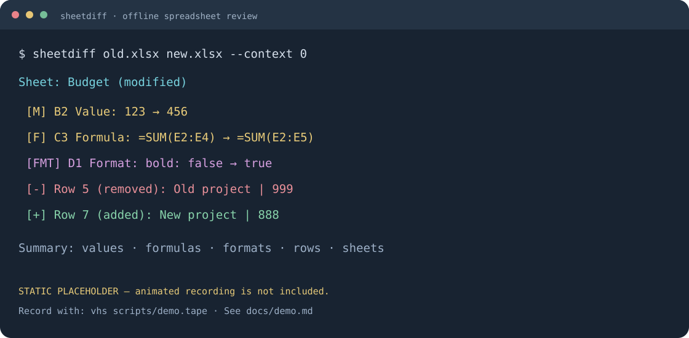

# sheetdiff

[](https://github.com/zz0639607-art/sheetdiff/actions/workflows/ci.yml) [](https://github.com/zz0639607-art/sheetdiff/releases) [](LICENSE)

**[Online HTML demo / 在线报告](https://zz0639607-art.github.io/sheetdiff/) · [Examples / 全部示例](docs/EXAMPLES.md) · [Downloads / 下载](https://github.com/zz0639607-art/sheetdiff/releases) · [Changelog / 更新记录](CHANGELOG.md)**

**Review Excel and CSV changes one cell at a time.** `sheetdiff` is an offline Rust CLI that compares `.xlsx` and `.csv` files, prints a colored diff, and produces standalone HTML or versioned JSON reports. It builds into one executable named `sheetdiff`.

**让 Excel 和 CSV 也能逐单元格 review。** `sheetdiff` 是完全离线运行的 Rust 命令行工具，支持彩色终端 diff、单文件 HTML 报告和带版本号的 JSON。构建后只需运行一个 `sheetdiff` 可执行文件。所有用户界面和诊断均使用英文。



This image is a **recording placeholder**, not an animated demo. Generate `docs/demo.gif` with [VHS](https://github.com/charmbracelet/vhs) or record a local cast with [asciinema](https://docs.asciinema.org/manual/cli/quick-start/), using the commands in [Record the demo](#record-the-demo--录制演示).

上图是**演示录制占位图**。下文提供 VHS 动图脚本和 asciinema 本地录制命令。

## Install / 安装

The public source repository is [zz0639607-art/sheetdiff](https://github.com/zz0639607-art/sheetdiff). Download available builds from [GitHub Releases](https://github.com/zz0639607-art/sheetdiff/releases). The project is not yet published to crates.io or Homebrew; installation from source works now.

完整源码公开于 [zz0639607-art/sheetdiff](https://github.com/zz0639607-art/sheetdiff)，可用发行包见 [GitHub Releases](https://github.com/zz0639607-art/sheetdiff/releases)。尚未发布到 crates.io 或 Homebrew，当前可直接从源码安装。

### From this checkout / 从源码安装

Install Rust stable, then run these commands in the project directory:

安装 Rust stable 后，在项目根目录执行：

```sh
git clone https://github.com/zz0639607-art/sheetdiff.git
cd sheetdiff
cargo install --path . --locked
sheetdiff --version
```

The initial build downloads Rust crates. The installed executable performs **no network requests** and needs no Rust, Python, Excel, or other application runtime. It uses normal operating-system libraries. For development on a machine with cached dependencies, `cargo test --offline` also works.

首次构建需要下载 Rust 依赖。安装后的可执行文件**不会发起网络请求**，运行时无需 Rust、Python、Excel 等应用运行环境，只使用操作系统常规库。依赖已缓存时，也可用 `cargo test --offline` 进行开发验证。

After a crates.io release has actually been published, users can instead install with:

正式发布到 crates.io 后，可使用：

```sh
cargo install sheetdiff --locked
```

**Name check:** before `cargo init`, `cargo search sheetdiff --limit 5` completed successfully with no matching result on **2026-10-25**. The crate name was therefore set to `sheetdiff`; the binary is also `sheetdiff`. This records the check, not a reservation of the registry name.

**重名检查：** 在 `cargo init` 前，于 **2026-10-25** 执行 `cargo search sheetdiff --limit 5`，命令成功且未返回同名结果。因此 crate 名和二进制名均为 `sheetdiff`。该记录不代表已经预留 crates.io 名称。

### Prebuilt binaries / 预编译二进制

Download available archives for Linux, macOS, or Windows from [GitHub Releases](https://github.com/zz0639607-art/sheetdiff/releases), verify its published SHA256 checksum, extract it, and put `sheetdiff` (`sheetdiff.exe` on Windows) on your `PATH`. The tag workflow builds and uploads the three platforms. Check the release assets for the architectures currently available.

可从 GitHub Releases 下载已提供的 Linux、macOS 或 Windows 压缩包，核对 SHA256，解压并把二进制加入 `PATH`。标签工作流负责三平台构建与上传，具体可用架构以 Release 附件为准。

### Homebrew source installation / 使用 Homebrew 从源码安装

There is no published Homebrew formula or tap. On a Homebrew-equipped Mac, install Rust through Homebrew and then install this checkout:

当前没有已发布的 Homebrew formula 或 tap。已安装 Homebrew 的 macOS 用户可执行：

```sh
brew install rust
cargo install --path . --locked
```

## Quick start / 快速上手

```sh
sheetdiff old.xlsx new.xlsx
sheetdiff old.xlsx new.xlsx --sheet "预算表" --sheet "Forecast"
sheetdiff old.xlsx new.xlsx --epsilon 0.001 --skip-format
sheetdiff old.csv new.csv --delimiter ";" --no-header
sheetdiff old.xlsx new.xlsx --html report.html --json report.json
sheetdiff old.xlsx new.xlsx --summary-only
```

The included synthetic budget workbooks can be compared directly. Regenerate them from Rust code if needed:

随项目提供的预算表是合成测试数据，可直接比较；需要时可从 Rust 代码重新生成：

```sh
cargo test --test fixtures regenerate -- --ignored
cargo run -- tests/fixtures/budget_v1.xlsx tests/fixtures/budget_v2.xlsx
```

Terminal output has the following structure; details depend on the inputs:

终端输出结构如下，具体变更和统计取决于输入文件：

```text
--- a: old.xlsx
+++ b: new.xlsx

Sheet: 预算表 (modified)
 [M]    B2  Value: 123 → 456
 [F]    C3  Formula: =SUM(C2:C4) → =SUM(C2:C5)
 [FMT]  D1  Format: bold: false → true
 [+]    Row 5 (added): A5: 新项目 | B5: 888

Summary: 1 sheets changed | ...
```

Changes use green for additions, red for removals, yellow for value/formula changes, magenta for format changes, and cyan for file/sheet headers. Tables handle mixed Chinese and English text. Added/deleted rows appear as blocks, and added/deleted sheets have an aggregate terminal summary. Merge ranges are annotated, for example `(merged A1:B2)`.

新增为绿色、删除为红色、值或公式变化为黄色、格式变化为品红、表头为青色。终端表格支持中英文混排；整行增删按块展示，新增/删除的 sheet 使用汇总展示。合并区域会标注为 `(merged A1:B2)`。

## CLI reference / 参数说明

```text
sheetdiff <old> <new> [OPTIONS]
sheetdiff --help
sheetdiff --version
```

| Option | Default | Behavior / 作用 |
| --- | --- | --- |
| `--sheet NAME` | all sheets | Repeat to select exact sheet names; CSV uses `CSV`. / 可多次指定 sheet 名称，CSV 的逻辑 sheet 名为 `CSV`。 |
| `--skip-format` | false | Ignore direct style and merge-layout changes. / 忽略直接样式及合并区域变化。 |
| `--skip-formula` | false | Ignore formula text; cached values still compare. / 忽略公式文本，缓存值仍参与比较。 |
| `--epsilon FLOAT` | `1e-9` | Finite, nonnegative **absolute** numeric tolerance. / 有限、非负的**绝对**数值容差。 |
| `--no-header` | false | Treat the first CSV record as data. / CSV 首条记录按数据处理。 |
| `--delimiter CHAR` | `,` | One ASCII character; quote, NUL, and newlines are rejected. / 指定单个 ASCII 分隔符，不接受引号、NUL 和换行。 |
| `--color always\|never\|auto` | `auto` | Auto disables ANSI color when stdout is not a TTY. / 非 TTY 输出自动关闭 ANSI 颜色。 |
| `--context N` | `2` | Show N neighboring unchanged physical rows; `0` hides context. / 显示相邻 N 行未变化内容，`0` 关闭。 |
| `--html FILE` | none | Save a single offline HTML file. / 输出可离线打开的单文件 HTML。 |
| `--json FILE` | none | Save the complete `sheetdiff/v1` report. / 输出完整机器可读 JSON 报告。 |
| `--summary-only` | false | Terminal summary only; report files remain complete. / 终端只显示摘要，不影响报告文件。 |
| `--help`, `--version` | — | Print help or the version. / 查看帮助或版本。 |

Both input files may be `.xlsx` or `.csv`; names are case-insensitive by extension. Unknown requested sheet names and unsupported file types are errors. HTML/JSON destinations must differ from the inputs and from each other. Report files are generated for identical inputs too.

输入支持 `.xlsx` 和 `.csv`，扩展名大小写不敏感。指定不存在的 sheet 或不支持的格式会报错。HTML/JSON 输出文件不能覆盖输入文件，也不能彼此重名；相同输入也会生成报告。

| Exit code | Meaning / 含义 |
| --- | --- |
| `0` | No difference under the selected options. / 按所选选项比较后无差异。 |
| `1` | Differences found. / 存在差异。 |
| `2` | File, parsing, argument, or report-writing error; diagnostic goes to stderr. / 文件、解析、参数或报告写入错误，诊断写入 stderr。 |

## How comparison works / 比较规则

Sheets align by name, columns by zero-based physical index, and displayed coordinates use A1 notation. A hand-written LCS finds equal-row anchors; rows between anchors are compared positionally, with excess rows reported as additions/deletions. This keeps row blocks and both original coordinates available without a separate diff dependency, and allows explicit resource limits. Identical prefixes/suffixes are trimmed first.

sheet 按名称对齐，列按物理索引对齐，显示坐标统一采用 A1。手写 LCS 先寻找相同行锚点，再按位置比较锚点之间的替换行，多出的行判定为新增或删除。这样便于保留行块和两侧原始坐标，并直接约束资源消耗，无需额外 diff 算法依赖。算法会先裁剪相同前后缀。

There is no declared row key. If an insertion is adjacent to a fully rewritten row with no matching anchor, positional replacement is intentionally used; the tool cannot infer identity that the file does not provide. Duplicate-row ties are deterministic. If alignment exceeds **4,000,000 matrix entries** or an estimated **8,000,000 cell checks**, it emits a warning and compares all remaining cells positionally. The matrix bound is about 16 MiB. Sparse physical row movement is checked separately so equal content at a different coordinate is not silently lost.

工具不假定某列是主键。如果插入行紧邻被完全改写、又缺少匹配锚点的行，会按位置比较；文件中未声明的行身份无法可靠推断。重复行的匹配结果是确定的。LCS 超过 **400 万矩阵项**或估计 **800 万次单元格检查**时，会给出提示并降级为位置比较，仍比较全部单元格；矩阵内存约限制为 16 MiB。稀疏物理行移动会单独检查，避免遗漏坐标变化。

Values, formulas, and formats are independent events, so one coordinate may have several events. Missing cells differ from explicitly present blank cells. Dates normalize to ISO 8601 without inventing a timezone; elapsed durations use ISO 8601 duration notation. Formula text and stored cached values are read separately; formulas are **not recalculated**. `--skip-formula` therefore still reports a changed cached value.

值、公式、格式是独立事件，同一坐标可以包含多种变化。缺失单元格与显式空单元格有区别。日期转换为 ISO 8601，不添加虚构时区；时长使用 ISO 8601 时长表示。公式与缓存值分别读取，**不会重新计算公式**，因此 `--skip-formula` 仍会报告缓存值变化。

Changing only a number format between a date and General is a format event, not a value edit; `--skip-format` ignores it. The original serial is kept internally for that comparison and is not added to JSON.

只把数字格式从日期切换为 General（或反向切换）时，仅记录格式变化；`--skip-format` 可忽略。内部保留原始序列号用于比较，不额外写入 JSON。

CSV files share the sheet name `CSV`. The first record is retained at row 1 and supplies display labels unless `--no-header` is set. Duplicate headers get unique suffixes such as `amount#2`. Finite JSON-number data fields become numeric values for epsilon comparison, while identifiers such as `001` remain strings; the original numeric spelling is kept for display. CSV booleans remain text. Empty fields and missing trailing fields remain distinct.

CSV 的逻辑 sheet 名统一为 `CSV`。默认保留首条记录为第 1 行，同时用作列显示名；`--no-header` 可关闭该行为。重复表头自动追加 `#2` 等唯一后缀。可解析为有限 JSON 数字的数据字段参与数值容差比较，`001` 等标识符保持字符串，数字原始写法用于显示。CSV 布尔文本仍作为文本，空字段与缺失尾部字段也有区别。

## Formats, large files, and reports / 格式、大表及报告

[`calamine`](https://docs.rs/calamine/) reads XLSX values/formulas, and [`csv`](https://docs.rs/csv/) reads CSV. Small ZIP/XML readers resolve workbook relationships, explicit blanks, merge ranges, and direct semantic formatting: bold, italic, fills, font name/size/color, number format, and alignment. Cell, row, column, named-style, and theme references are resolved before comparison. This is direct cell formatting comparison; conditional-format rule evaluation and Excel's full locale-specific display engine are outside this version.

XLSX 值和公式由 `calamine` 读取，CSV 由 `csv` 读取。轻量 ZIP/XML 解析补充工作簿关系、显式空单元格、合并区域和直接格式：粗体、斜体、填充、字体名称/大小/颜色、数字格式及对齐。比较前会解析单元格、行、列、命名样式和主题引用。本版本比较直接单元格格式，不执行条件格式规则，也不复刻 Excel 的完整本地化显示引擎。

XLSX cells are streamed into sparse maps. A far-away cell does not cause allocation of the surrounding empty rectangle. Resource guards reject sheets with more than **1,000,000 present cells**, XML parts larger than **64 MiB**, total XML larger than **256 MiB**, or XML documents exceeding **2,000,000 nodes**. Exceeding a reader limit is an explicit error, not a partial comparison.

XLSX 通过流式读取保存为稀疏结构，远处单个单元格不会导致分配整个空白矩形。资源保护上限为每个 sheet **100 万个已存在单元格**、单个 XML 部件 **64 MiB**、XML 总计 **256 MiB**、单个 XML 文档 **200 万节点**。超限会明确报错，不会返回部分比较结果。

Terminal detail is limited to **1,000 rows/events per sheet**; row-block text previews at most 100 cells. HTML displays at most **1,000 rows and 100 populated columns per changed sheet**, with red/green old/new cells, hover details, CSS sheet tabs, and unchanged sheets in a gray collapsed section. HTML contains its own CSS and has no JavaScript or external assets, so it opens directly in Chrome offline. Display truncation is visibly marked. **JSON retains the full report**, including all changed cells and row events.

终端每个 sheet 最多展示 **1,000 行/事件**，行块文本最多预览 100 个单元格。HTML 每个变更 sheet 最多展示 **1,000 行、100 个已存在列**，提供红绿高亮、悬浮详情、CSS sheet 切换和灰色未变化 sheet 折叠区。HTML 内嵌 CSS，不包含 JavaScript 或外部资源，可直接离线用 Chrome 打开。截断会显式提示；**JSON 始终保留完整事件和统计**。

See [JSON schema documentation](docs/json-schema.md) and the [formal v1 schema](docs/sheetdiff-v1.schema.json) for field types, independent event counters, null/presence semantics, and `jq` examples.

JSON 字段类型、独立事件统计、空值语义及 `jq` 示例见 [JSON Schema 文档](docs/json-schema.md)和[正式 v1 Schema](docs/sheetdiff-v1.schema.json)。

## Git integration / Git 集成

Configure the executable once, using the shell quoting shown below:

在 shell 中执行以下配置，保留引号以正确传递含空格的文件路径：

```sh
git config --global difftool.sheetdiff.cmd 'sheetdiff "$LOCAL" "$REMOTE"'
git config --global diff.tool sheetdiff
git difftool --tool=sheetdiff --no-prompt -- path/to/budget.xlsx
```

For scripts that need sheetdiff's exit status, add `--trust-exit-code`. Git normally ignores external difftool statuses; with this flag it forwards a nonzero result and stops, including the expected status 1 for differences. See the [Git difftool documentation](https://git-scm.com/docs/git-difftool.html).

脚本需要保留退出码时可添加 `--trust-exit-code`。Git 默认忽略外部 difftool 的退出码；添加后会转发非零状态并停止，包括表示正常发现差异的退出码 1。多文件交互 review 时可使用默认行为继续查看后续文件。

```sh
git difftool --tool=sheetdiff --trust-exit-code --no-prompt -- path/to/budget.xlsx
```

Suggested `.gitattributes`:

建议 `.gitattributes` 内容：

```gitattributes
*.xlsx binary
*.csv text
```

`git diff --no-index old.csv new.csv` provides ordinary line comparison outside a repository. For XLSX, regular `git diff --no-index old.xlsx new.xlsx` normally reports a binary difference. Use `sheetdiff old.xlsx new.xlsx` for its equivalent cell-level comparison, or route Git's no-index comparison through the configured tool:

`git diff --no-index` 可在仓库外比较两个文件；CSV 使用常规行 diff，XLSX 通常只显示二进制不同。逐单元格比较可直接运行 sheetdiff，或通过以下 Git difftool 包装调用：

```sh
git difftool --no-index --tool=sheetdiff --trust-exit-code --no-prompt old.xlsx new.xlsx
```

Git's no-index difference status is 1 too; it is not a sheetdiff runtime error. `git diff` does not automatically invoke a configured `git difftool`.

Git no-index 发现差异时同样返回 1，不应视为 sheetdiff 运行错误。配置 `git difftool` 不会使普通 `git diff` 自动调用它。

## Development / 开发

Core logic is in `src/lib.rs`; `src/main.rs` adapts it to clap and report files. Modules separate `reader`, `model`, `diff`, `render`, and `cli`. XLSX fixtures are generated by the dev-only `rust_xlsxwriter` dependency. No async runtime, web framework, AI dependency, or network client is used by the executable.

核心逻辑位于 `src/lib.rs`，`src/main.rs` 负责 CLI 适配和报告输出。`reader`、`model`、`diff`、`render`、`cli` 职责分离。XLSX 测试夹具由仅用于开发的 `rust_xlsxwriter` 生成。可执行文件不使用异步运行时、Web 框架、AI 依赖或网络客户端。

```sh
cargo fmt --check
cargo clippy -- -D warnings
cargo test --locked
cargo build --release --locked
```

GitHub Actions runs formatting, clippy, and tests on Linux, macOS, and Windows. The release workflow builds and uploads platform archives when a version tag is pushed. See [CONTRIBUTING.md](CONTRIBUTING.md) for fixture generation, test guidance, and review expectations.

GitHub Actions 在 Linux、macOS、Windows 上执行格式、clippy 和测试检查。版本标签触发三平台发行包构建及上传。测试夹具、贡献方式和 review 约定见 [CONTRIBUTING.md](CONTRIBUTING.md)。

## Record the demo / 录制演示

Run from the project root after installing the optional recording tools. The VHS script generates `docs/demo.gif`:

安装可选录制工具后，在项目根目录执行。VHS 脚本会生成 `docs/demo.gif`：

```sh
cargo test --test fixtures regenerate -- --ignored
cargo build --release --locked
vhs scripts/demo.tape
```

To record and replay a local asciinema cast instead:

也可用 asciinema 录制并回放本地 cast：

```sh
asciinema rec -c './target/release/sheetdiff tests/fixtures/budget_v1.xlsx tests/fixtures/budget_v2.xlsx --color always --context 0' docs/demo.cast
asciinema play docs/demo.cast
```

Asciinema records a `.cast`, while VHS creates a GIF. These are optional development tools and do not become runtime dependencies. Replace the placeholder image above with `` after recording.

asciinema 输出 `.cast`，VHS 输出 GIF。它们只是可选开发工具，不会成为运行依赖。录制后可把本文占位图改为 ``。

## Publish a release / 发布步骤

These are maintainer instructions for future releases. The public repository is configured below; crates.io publication is a separate, deliberate action. Commit reviewed source/fixture changes and check that the crate name is still available before the first registry publication.

以下为维护者后续发布步骤。公开仓库地址已配置，crates.io 发布仍需单独执行。请先提交 review 后的源码及夹具；首次上传 crates.io 前再次检查 crate 名称。

```sh
cargo fmt --check
cargo clippy -- -D warnings
cargo test --locked
cargo build --release --locked
cargo package --locked
cargo publish --dry-run --locked
```

After reviewing the package and configuring the maintainer's crates.io credentials, publish it deliberately:

检查打包内容并配置维护者的 crates.io 凭据后，按需执行正式发布：

```sh
cargo publish --locked
```

For GitHub Releases, push a version tag after the ordinary branch push; the included workflow builds the Linux/macOS/Windows archives and attaches them to that tag's release:

GitHub Release 先推送正常分支，再推送版本标签，由工作流构建并上传三平台压缩包：

```sh
git tag v0.1.0
git push origin v0.1.0
```

The repository needs Actions enabled and the workflow's release job needs `contents: write`. Platform packaging can also be run with `scripts/build-release.sh` or `scripts/build-release.ps1`; a compatible host compiler/target must be installed. Changing `Cargo.toml`'s version and release notes precedes subsequent tags.

仓库需启用 Actions，发行任务需具备 `contents: write` 权限。也可使用 `scripts/build-release.sh` 或 `scripts/build-release.ps1` 本地打包，前提是已安装对应宿主编译器和目标工具链。后续发行应先更新 `Cargo.toml` 版本及发行说明，再创建标签。

## Scope and roadmap / 范围与路线图

Version 0.1 focuses on read-only `.xlsx`/CSV comparison and reports. Legacy `.xls`/`.xlsb` and formula dependency graph analysis are roadmap items. GUI, web services, cloud storage, AI features, workbook merge/write-back, and VBA parsing are outside this version.

v0.1 聚焦 `.xlsx`/CSV 只读比较和报告。旧版 `.xls`/`.xlsb`、公式依赖图分析列入后续路线图。本版本不包含 GUI、Web 服务、云端、AI、工作簿合并或回写、VBA 解析。

## License / 许可

[MIT](LICENSE), copyright 2026 sheetdiff contributors. Contributions follow the same license.

采用 [MIT 许可证](LICENSE)，版权归 2026 sheetdiff contributors。贡献代码使用相同许可。
